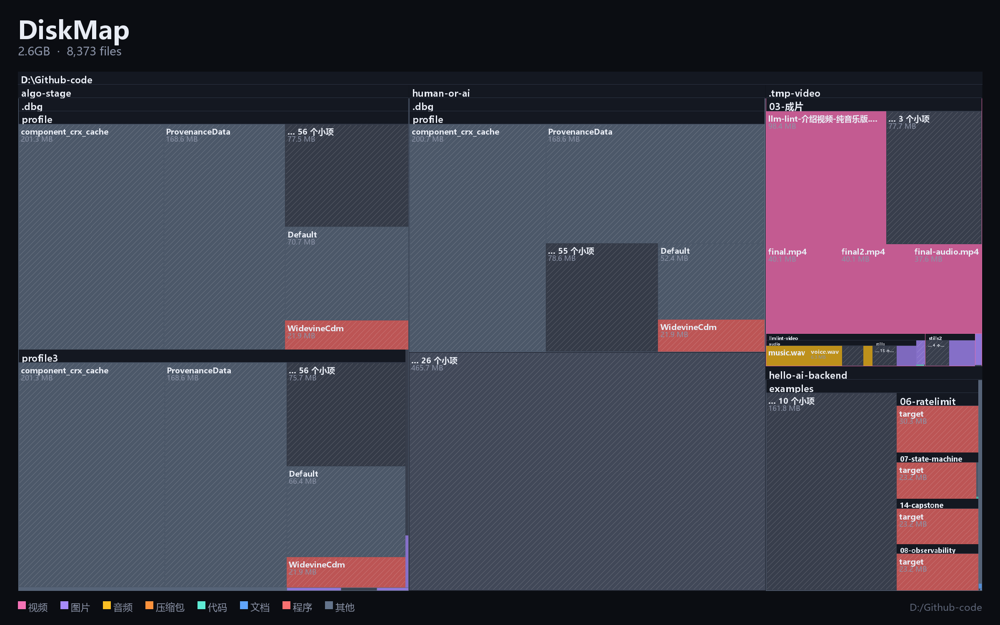

# DiskMap

看清一块硬盘上到底装了什么。扫描任意目录，几秒钟生成一张**单文件、离线、可交互**的矩形树图报告：
面积等于体积，颜色等于文件类型，点进去可以一层层下钻。

```bash
python -m diskmap.cli D:/Github-code
```

打开后就是这样一张图（这是扫 `D:\Github-code` 的真实结果）：



## 它解决什么

"磁盘满了"是个假问题。真实问题是**某个你从没听说过的目录占了一半空间**，
而资源管理器只按名字排序，永远不告诉你谁在偷空间。

DiskMap 用面积说话。一屏之内你就能看出：

- 那块 40% 的紫色是 `algo-stage`，里面全是训练产物
- 那块 12% 的粉色是 `.tmp-video`，是以前渲染视频留下的
- 三块一样大的 `ProvenanceData` 是**同一个文件的三份副本**

## 三种视图

| 视图 | 回答的问题 |
| --- | --- |
| **树图** | 空间在哪？点进去逐层下钻，右键返回 |
| **最大文件** | 具体是哪几个文件？ |
| **重复文件** | 哪些东西我存了不止一份？ |
| **一年没动** | 哪些大文件其实早就死了？ |

后三个视图在右侧面板，带搜索框，可以按文件名或扩展名过滤。

## 输出

报告是一个 `.html` 文件，**没有任何外部依赖**——没有 CDN、没有 `node_modules`、
没有网络请求。数据以 JSON 内嵌在页面里，双击就能离线打开，发给别人也能看，
十年后还能打开。

体积在 500 KB 上下：扫描时会按体积排序，每层只保留最大的 80 个子项，
其余的折叠成一个带斜纹的「… N 个小项」块。这是刻意的取舍——
决定空间去向的永远是少数大块，几千个 3 KB 的小文件只会把图变成噪点。

> 斜纹不是装饰。一块 200 MB、由几千个小文件组成的灰色矩形，如果涂成纯色，
> 看起来和"空目录"一模一样。斜纹是视觉上的"这里是一堆东西，但没一个是大的"。

## 速度

`os.scandir` 加显式栈，不用 `os.walk`，也不用 `Path.rglob`：

| 目标 | 文件数 | 体积 | 耗时 |
| --- | --- | --- | --- |
| `D:\Github-code` | 8,374 | 2.6 GB | 3.4 s |
| `C:\Windows\System32` | 25,365 | 11.3 GB | 4.6 s |

重复文件检测用两级哈希：先对前 256 KB 做 `blake2b` 剪枝，只有头部相同才读全文确认。
所以 800 MB 的重复文件，实际磁盘读取量远小于 800 MB。

## 用法

```bash
# 扫当前目录
python -m diskmap.cli

# 扫指定目录，指定输出
python -m diskmap.cli D:/Projects -o report.html

# 额外排除某些目录
python -m diskmap.cli D:/ --exclude node_modules --exclude .venv

# 不排除任何东西（更慢，报告更大）
python -m diskmap.cli D:/ --all
```

默认排除：`$Recycle.Bin`、`System Volume Information`、`Windows.old`、
`$WinREAgent`、`node_modules`、`.git`。

## 导出海报

想要一张能直接发出去的图，而不是一个网页：

```python
from diskmap.scan import scan, to_json
from diskmap.render import render_poster

root, extra = scan("D:/Github-code")
render_poster(to_json(root), "poster.png", title="DiskMap",
              subtitle="2.6GB · 8,374 files", footer="D:/Github-code")
```

Pillow 渲染器与网页版的布局代码是**两份独立实现、同一套规则**：
同样的 squarified 算法、同样的深度明暗表 `[1.00, 0.93, 0.86, 0.80, 0.76, 0.73, 0.71]`、
同样的标题带、同样的斜纹。所以截图和海报看起来是同一个东西。

## 结构

```
diskmap/
  scan.py      扫描 + 汇总 + 重复检测，约 300 行
  report.py    单文件 HTML，布局全部在浏览器 canvas 里做
  render.py    Pillow 渲染器，供海报和视频用
  cli.py       命令行
tools/
  check_report.js   不启动浏览器，用 stub DOM 真跑一遍页面脚本并校验几何
  poster.py         一行出图
```

`check_report.js` 值得单独说。浏览器的 headless 截图在这个环境里跑不起来
（Edge 报 `Check failed: . : 拒绝访问 (0x5)`），所以页面脚本是靠一个
**假 DOM、假 canvas** 在 Node 里真跑一遍验证的：它检查脚本不抛异常、
所有矩形都在画布内、网格覆盖率 ≥ 88%（证明布局没留缝）、
点击能下钻且能返回、三个标签页都不为空、搜索框真的会过滤。

这不是"能跑就行"的烟测，它抓到过三个真 bug：父节点入栈顺序错了导致永远
只能点最外层、`hitTest` 返回的是 box 却当 node 用、以及斜纹线的端点没裁剪
导致画到隔壁方块里。

## 配套短视频

两条 1080×1920 竖屏、30fps、无音轨。这个环境里 headless 浏览器起不来，
所以没有录屏——每一帧都是 Pillow 画出来再用 ffmpeg 编的。

| 文件 | 时长 | 讲什么 |
| --- | --- | --- |
| `out/v1-cdrive.mp4` | 41s | 《C 盘解剖》：214GB 全盘扫一遍，直接指出去哪了。764,363 个文件、209 秒、重复文件 12.8GB、一年没动 16.5GB |
| `out/v2-two-rulers.mp4` | 37s | 《两把尺子》：同一个文件夹按体积看和按文件数看是两个世界。`.tmp-video` 与 `hello-ai-backend` 体积只差 6%，文件数差 74 倍 |

```bash
python video/v1.py                    # 编码 v1
python video/v2.py                    # 编码 v2
python video/v1.py stills 1 6.5 14    # 只出单帧挑构图，几秒钟
```

`video/kit.py` 是可复用的动画工具包：缓动、中英混排断行、发光标题、有序抖动。
**抖动必须加在编码路径上**——暗色渐变经过 H.264 的 yuv420p 量化会出现横贯全屏
的色带，加 ±3 的 Bayer 抖动后才消失；只在预览图上加抖动会骗自己。

## 已知限制

- 需要读权限的目录会跳过并计数，报告里不会出现（`System32` 下有 20 个）
- 符号链接和 junction 不跟随，避免扫出环
- 内存中保存整棵树，扫千万级文件的盘需要几个 GB 内存
- 只测过 Windows；路径处理用的是 `os.path`，macOS/Linux 上应该能跑但没验证
